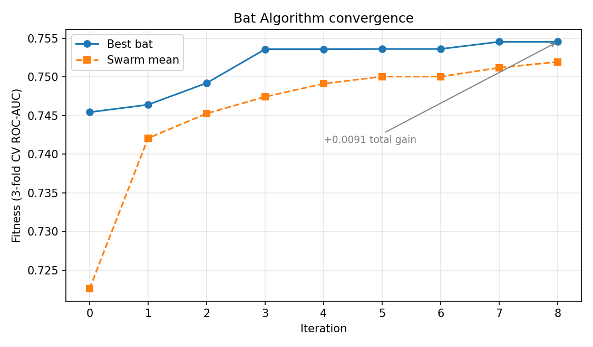
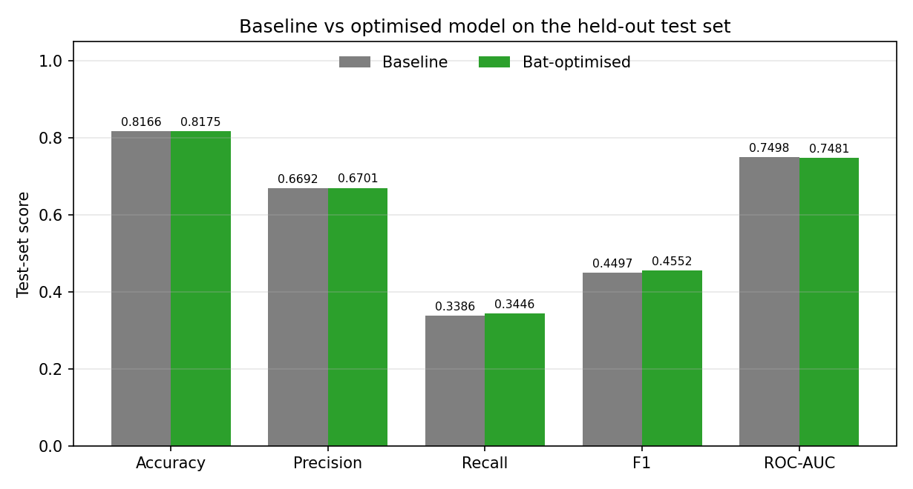
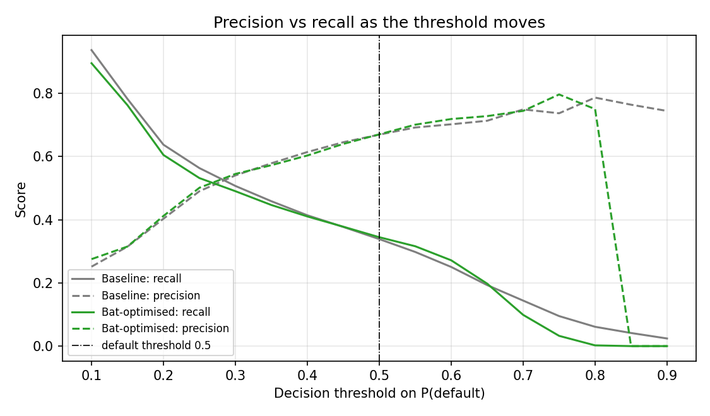

# Credit Card Default Prediction with an ANN Optimized by the Bat Algorithm

A bio-inspired hyperparameter search for a neural network that predicts whether a credit card client will default next month.

---

## Key Finding

The Bat-optimised network did **not** outperform an untuned baseline in a meaningful way. The differences are within normal split-to-split variation. Recall at the default threshold (0.5) is low for both models, catching about one defaulter in three, so the decision threshold matters more than hyperparameter tuning for this problem.

| Model (test set, n = 5,993) | Accuracy | Precision | Recall | F1 | ROC-AUC | RMSE |
|---|---|---|---|---|---|---|
| Baseline ANN | 0.8166 | 0.6692 | 0.3386 | 0.4497 | 0.7498 | 0.3735 |
| Bat-optimised ANN | 0.8175 | 0.6701 | 0.3446 | 0.4552 | 0.7481 | 0.3738 |

---

## Figures

All figures are generated from the experiment's outputs by `make_figures.py`.

### Figure 1: Bat Algorithm convergence



The solid line is the best cross-validated AUC found so far. The dashed line is the average over all bats. Both rise over the iterations, meaning the search is finding better configurations. Most of the gain arrives in the first four iterations, after which the best value barely moves. This means the search at this budget has largely converged. A small gap between the two lines indicates the swarm has settled on solutions of similar quality.

### Figure 2: Baseline vs Bat-optimised on the test set



Each pair of bars shows one metric on the same held-out test set. The differences are very small: accuracy +0.0009, precision +0.0009, recall +0.0060, F1 +0.0055, and ROC-AUC −0.0017. These are within the variation expected from a single random split, so the optimiser did not produce a meaningful improvement. Recall, the share of actual defaulters caught, is the weakest score for both models.

### Figure 3: Threshold trade-off



Lowering the decision threshold classifies more clients as defaulters. Recall (solid lines) rises because more real defaulters are caught, while precision (dashed lines) falls because more flagged clients are false alarms. The right threshold depends on which error is more costly for the lender. It should be chosen on validation data rather than on the test set, which is why the threshold analysis here is descriptive only.

Further plots (learning curves and ROC curves) are generated by `run.py` into `results/`.

## Contents

- [Quick start](#quick-start)
- [Project structure](#project-structure)
- [How it works](#how-it-works)
- [Outputs](#outputs)
- [Verification](#verification)
- [Options](#options)
- [Limitations](#limitations)
- [References](#references)

---

## Quick Start

**1. Get the dataset.** Download *Default of Credit Card Clients* from Kaggle or the UCI Machine Learning Repository. Save the CSV in the `data/` folder under either name:

- `data/default_of_credit_card_clients.csv`
- `data/UCI_Credit_Card.csv`

Do not commit the dataset to git. `data/` is listed in `.gitignore`.

**2. Install dependencies.**

```bash
pip install -r requirements.txt
```

**3. Run the experiment.**

```bash
python run.py
```

On a standard laptop CPU this takes about 2.5 to 5 minutes. All outputs are written to `results/`.

**4. Check the pipeline.**

```bash
python tests/verify.py
```

Every line should show `[PASS]`.

**Windows users:** if the dataset is elsewhere on your machine, pass its path on the command line instead of editing the code:

```powershell
python run.py --data "C:\path\to\UCI_Credit_Card.csv"
```

---

## Project Structure

```
credit_default_bat_aat/
├── README.md                 this file
├── requirements.txt          library dependencies
├── .gitignore                excludes data/ and results/
├── run.py                    entry point: runs the full experiment
├── src/
│   ├── data.py               loading, cleaning, recoding, stratified split
│   ├── model.py              ANN (MLP) pipeline and baseline configuration
│   ├── bat.py                Bat Algorithm search
│   └── evaluate.py           metrics, threshold analysis, plots
├── tests/
│   └── verify.py             23 automated correctness checks
├── data/                     place the dataset CSV here (not committed)
└── results/                  generated outputs (not committed)
```

---

## How It Works

### 1. Data

The dataset has 30,000 Taiwanese credit card clients, 23 explanatory variables, and a binary target (default next month). Cleaning:

- The ID column is dropped.
- Non-numeric entries are coerced to missing. Rows with missing values and duplicate rows are removed: 35 rows in total, leaving 29,965.
- Undocumented codes are recoded: `EDUCATION` values 0, 5, 6 become 4 ("other"); `MARRIAGE` value 0 becomes 3 ("other").
- Repayment codes −2, −1, 0 are kept, since they have defined meanings.

The data is split 80/20 with stratification: 23,972 training and 5,993 test records. The default rate is 22.13% in both sets. Features are standardised inside the model pipeline, with the scaler fitted on training data only.

### 2. Model

A feed-forward neural network (multi-layer perceptron) trained with Adam, batch size 256, and early stopping. The **baseline** uses one hidden layer of 32 ReLU units, learning rate 0.001, and L2 penalty 0.0001. These values were chosen in advance and not tuned.

### 3. Bat Algorithm

The Bat Algorithm (Yang, 2010) is a nature-inspired optimiser based on the echolocation of microbats. Each "bat" is a candidate hyperparameter configuration, encoded as five values in [0, 1]:

| Dimension | Hyperparameter | Range |
|---|---|---|
| 0 | Hidden layer 1 units | 4 – 128 |
| 1 | Hidden layer 2 units (0 = none) | 0 – 64 |
| 2 | Learning rate | 10⁻⁴ – 10⁻¹ (log scale) |
| 3 | L2 penalty α | 10⁻⁶ – 10⁻¹ (log scale) |
| 4 | Activation | ReLU or tanh |

Each iteration applies the Bat operators:

- **Frequency:** `f = f_min + (f_max − f_min) · β`, with β uniform on [0, 1].
- **Velocity and position:** bats move toward the best solution found so far.
- **Local walk:** when a random draw exceeds the pulse rate, a bat takes a small random step around the best solution.
- **Acceptance:** a move is accepted if a random draw is below the loudness and the fitness improves. Accepted moves reduce loudness and raise the pulse rate, shifting the search from exploration toward exploitation.

**Fitness** is the mean ROC-AUC over stratified 3-fold cross-validation on the training data. The test set is never used during the search. For run time, the search uses a stratified 6,000-row subsample of the training set; the final models use the full training set.

Default settings: 10 bats, 8 iterations, 88 unique configurations evaluated.

### 4. Evaluation

Both models are evaluated once on the test set using accuracy, precision, recall, F1, ROC-AUC, and RMSE of predicted probabilities. The positive class is *default*, so recall is the share of actual defaulters the model catches. A threshold-sensitivity analysis reports precision, recall, and F1 at thresholds from 0.10 to 0.90. It is descriptive only and does not choose a threshold.

---

## Outputs

Running `python run.py` writes these files to `results/`:

| File | Contents |
|---|---|
| `metrics.csv` | Test-set metrics for the baseline and Bat-optimised models |
| `summary.json` | Dataset cleaning report, Bat settings, best hyperparameters, runtime |
| `bat_history.csv` | Best, mean, and worst CV AUC per Bat iteration |
| `threshold_sensitivity.csv` | Precision, recall, and F1 across decision thresholds |
| `convergence.png` | Bat Algorithm convergence curve |
| `learning_curves.png` | Training loss for both models |
| `metric_comparison.png` | Test metrics, side by side |
| `roc_curves.png` | ROC curves on the test set |
| `threshold_sensitivity.png` | Threshold sensitivity plot |

---

## Verification

`tests/verify.py` runs 23 checks, each printed as `[PASS]` or `[FAIL]`:

- **Data:** row count, no missing values, binary labels, default rate near 22%, 80/20 split, equal default rate in train and test, 23 features.
- **Search ranges:** every decoded configuration stays within the allowed limits.
- **No leakage:** the scaler is fitted on training data only.
- **Metrics:** recall, precision, and accuracy match values recomputed from the confusion matrix. AUC lies between 0.5 and 1.0.
- **Reproducibility:** the same seed gives the same best configuration, and the best fitness never decreases.
- **Saved results:** the test set is 20% of the cleaned data.

The script runs a small search in a few seconds. It does not reproduce the full experiment. Repeated full runs on the same data gave identical numbers.

---

## Options

```bash
python run.py --bats 20 --iters 15          # larger search budget
python run.py --metric f2                   # search for F2 (weights recall more)
python run.py --search-max-iter 200         # train candidates as long as final models
python run.py --search-size 0               # search on the full training set (slow)
python run.py --data path/to/file.csv       # use a dataset from another location
```

| Option | Default | Meaning |
|---|---|---|
| `--bats` | 10 | Number of bats in the search |
| `--iters` | 8 | Number of Bat iterations |
| `--metric` | `auc` | Search fitness: `auc`, `f1`, or `f2` |
| `--search-max-iter` | 100 | Training epochs per candidate during search |
| `--search-size` | 6000 | Training rows used for the search (0 = all) |
| `--data` | auto | Path to the dataset CSV |

Choose settings before looking at test results. Re-running with many settings and reporting only the best one inflates the reported performance.

---

## Limitations

- **Small search budget.** 10 bats and 8 iterations cover the five-dimensional space sparsely.
- **Search subsample.** The search uses 6,000 training rows, so the chosen configuration may differ from a full-data search.
- **Single split and seed.** Differences of this size need repeated runs to confirm.
- **Optimistic fitness.** Cross-validated AUC on the same training data used for selection is biased upward. The test set gives the unbiased estimate.
- **Epoch cap during search.** Some candidates hit the 100-epoch limit during search (a `ConvergenceWarning`), so slow-learning configurations may be undervalued. Final models allow 200 epochs.
- **No other baselines.** Logistic regression, random forest, and random search were not run with the same budget.
- **Optimiser not benchmarked.** The Bat implementation has not been checked on standard test functions.
- **Data age.** The data describes Taiwanese clients in 2005 and may not reflect current lending.
- **Not for production use.** This is a research prototype. Any real credit decision would need fairness audits across SEX, EDUCATION, MARRIAGE, and AGE, plus explainability checks.

---

## References

1. Yang, X.-S. (2010). A new metaheuristic bat-inspired algorithm. In *Nature Inspired Cooperative Strategies for Optimization (NICSO 2010)*, Springer, 65–74.
2. Yeh, I.-C., & Lien, C.-H. (2009). The comparisons of data mining techniques for the predictive accuracy of probability of default of credit card clients. *Expert Systems with Applications*, 36(2), 2473–2480.
3. Yeh, I.-C. (2016). Default of Credit Card Clients [Dataset]. UCI Machine Learning Repository.
4. Holland, J. H. (1975). *Adaptive Systems in Natural and Artificial Systems*. University of Michigan Press.
5. Kingma, D. P., & Ba, J. (2015). Adam: A method for stochastic optimization. *ICLR*.
6. Pedregosa, F., et al. (2011). Scikit-learn: Machine learning in Python. *JMLR*, 12, 2825–2830.
7. Lessmann, S., Baesens, B., Seow, H.-V., & Thomas, L. C. (2015). Benchmarking state-of-the-art classification algorithms for credit scoring: An update of research. *European Journal of Operational Research*, 247(1), 124–136.

---

## License

For academic use as part of the 23DS7BSBIO assessment. The dataset is subject to its own licence on the UCI / Kaggle page.